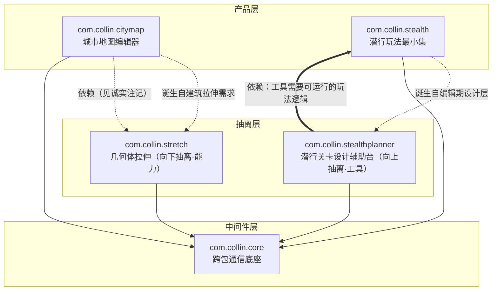

# Plugin Package · 有谱系的 Unity 6 插件合集

一个基于 **Unity 6**（6000.6.7f1）的插件包合集：若干可独立导出的 UPM 内嵌包 + 一个纯 UI 展板。三条探索线贯穿始终——**功能原型**（程序化城市、潜行玩法）、**编辑器工具**（所见即所得的参数驱动工作流）、以及 **多 AI Agent 并行介入下的工程方法**（写锁、门禁、证据化验收，规则真源见 [AGENTS.md](AGENTS.md)）。

## 包不是并列的货架，而是一条抽离谱系

这里的"独立成包"不等于"互相无关"。设计准则是：**一个产品内部的能力或工具，一旦足够简单、足够泛用、可以脱离母体单独复用，就从母包中抽离为独立包**。

抽离有**两个方向**，谱系必须分别对待：

- **向下抽离（能力）**：能力被产品使用，产品离不开它——`stretch` 抽离自 `citymap` 的建筑拉伸需求，导出 citymap 必须携带 stretch；而 stretch 单卖时只是一件轻工具。
- **向上抽离（工具）**：工具服务于产品运行时，工具离不开产品——`stealthplanner`（潜行关卡设计辅助台）抽离自 `stealth` 的编辑期设计层，但它**生效的前提是有一套可运行的潜行关卡逻辑**，所以导出工具必须带上玩法本体，而 stealth 独立导出、不含工具。

因此本仓库的正确读法是一棵谱系树，不是四件商品的并排陈列：



实线 = 依赖（导出时须随包）；虚线 = 抽离血缘（诞生方向）。注意**依赖边可以与血缘边反向**：stretch 诞生于 citymap、又被 citymap 依赖；stealthplanner 诞生于 stealth、却反过来需要 stealth——它的设计对象就是后者的关卡逻辑。

**展板即谱系视图**：`Showcase.json` 用两个可选字段承载谱系——`tier`（middleware / capability / product / tool）与 `extractedFrom`（诞生自哪个包）。展板左栏按血缘分组：中间件层一组，其余聚成产品线，母体在前、抽离品缩进跟随（↳ 标记）；右侧详情给出「抽离自 / 已抽离出」血缘行与按方向化导出闭包计算的「导出携带」清单。

**导出闭包一览**（"导出 X 时必须携带哪些包"）：

| 想要的东西 | 必须带上的包 | 依据 |
|---|---|---|
| 城市地图 citymap（产品） | citymap ＋ stretch ＋ core | 向下抽离：产品依赖能力 |
| 几何体拉伸（能力单卖） | stretch ＋ core | 只依赖底座 |
| 潜行玩法 stealth（产品） | stealth ＋ core | 玩法运行时自足，不含设计工具 |
| 潜行设计辅助台 stealthplanner | stealthplanner ＋ stealth ＋ core | 向上抽离：工具依赖产品运行时 |

## 逐包说明

### com.collin.core（v0.2.0）· 中间件层
只做跨包通信，不含任何业务：事件通道、服务注册表、ScriptableObject 信号；另提供展板条目发现、依赖拓扑排序与部分提取的依赖闭包计算。所有其他包依赖它，它不依赖任何包——这就是"中间件核心，仅跨包通信"的字面含义。

### com.collin.citymap（v0.0.1）· 城市地图编辑器（产品）
参数驱动、可人工干预的城市生产链路：
- **地形**：低频噪声＋平整约束，生成"整体起伏、局部平整"的可用地表，雕刻笔刷直接改形；
- **水系**：河流中心线笔刷自动下切河床，D8 汇流补支流，保证无死胡同；
- **路网**：点线手画主干骨架，按道路占比系数 ρ 细分式程序化补全支路；
- **建筑**：同心双圆柱场域烘焙出金融/工业/住宅/农业四维强度场，驱动建筑配置表"主导维硬过滤 → 加权随机"落位，并以场域强度拉伸高度形成天际线。

全流程确定性可复算；人工层与自动层分域，四层反悔＋锁区/负约束/固化局部回退；支持 8km+ 大尺度流式工作集，可导出 scene 切块 / 引擎无关数据 / 2D 瓦片三种形态。
**血缘**：建筑管线里"楼层沿单轴分段复制"这个需求，正是 stretch 包诞生的地方（向下抽离）。

### com.collin.stretch（v0.4.3）· 几何体拉伸（能力，向下抽离自 citymap）
因"足够简单、足够泛用"从城市地图中抽离为独立包：沿单轴对任意多面体做分段复制式拉伸——固定段刚性平移、可重复段整数倍复制；跨界三角形自动裁剪分片、切口 UV 插值，边界切在哪都对，窗户永不拉伸；碰撞体与刚体自动同步视觉尺寸；共享结构资产可被多实例以不同倍数复用。适合楼层、桥面、栏杆等模块化建筑，包内附编辑器实录演示视频。抽离的代价与收益都在谱系里：**单卖时它只是 core 之上的一件轻工具；随 citymap 导出时它是必需件。**

### com.collin.stealth（v0.4.0）· 潜行玩法最小集（产品）
- 巡逻路线以预制件承载（内部相对坐标），拖动一个根即可让整条路线与全部 NPC 轨迹一起搬移；
- NPC 位姿是**时间的纯函数**，编辑态与 Play 态共用同一条求值路径；
- 察觉判定走距离 → 视角锥 → 视线 → 遮蔽修正的**四层管线**，可按层取结果；察觉度累积驱动巡逻·疑惑·警觉·搜索四档状态机，追击走导航网格绕行；
- 视野/视距/视线高度/俯仰/遮挡层等共享资产可被多实例覆盖复用；包内自带拆箱即用的玩家控制器（WASD＋蹲伏）与白盒演示场景。

**血缘（已落地）**：编辑器侧的潜行**设计工具**——巡逻路线编辑、回溯擦洗窗口、预制件烘焙——已按向上抽离的方向独立为 `com.collin.stealthplanner`。它作用的每一个对象（路线、NPC 状态、察觉判定参数）都由 `stealth` 的运行时解释执行：**没有可运行的潜行关卡逻辑，设计工具就没有意义**。实现形态走"方案 P"：契约层（接口 + 纯数据 DTO + 事件通道）上提进 `core`，stealthplanner 包级只声明依赖 core、经契约调用 stealth 运行时（玩法包缺席时优雅降级）——但**导出使用时必须带上 stealth**，这条运行依赖由展板谱系如实呈现。`stealth` 本体只保留玩法运行时，独立导出、不携带工具。

### com.collin.stealthplanner（v0.0.1）· 潜行关卡设计辅助台（工具，向上抽离自 stealth）
潜行关卡的策划辅助台：基于玩法包的纯函数位姿与视野判定，把整条巡逻相位烘焙成**时空可见性查找表**；设计态离线求解对局可行解、驱动可拖动时间轴回溯展示 NPC 位置与危险/安全区域、枚举并导出玩家路点数据集，并可按给定动线反向规划 NPC 巡逻路点。安全岛判定经 core 契约反向注入玩法包，本包只依赖 core、玩法包缺席时优雅降级。它是"工具离不开运行时"这一抽离方向的示范：谱系上诞生自 stealth，使用与导出却反过来需要 stealth。

## 关于依赖方向的一个诚实注记

谱系是设计事实，但**包级强依赖声明目前一律只到 core**：`citymap` 把建筑高度解算做在自身内部（`RecordGeometry` 行内分段），`package.json` 未声明对 stretch 的依赖；`stealthplanner` 经 core 的契约层（接口 + DTO + 通道）软调用 stealth 运行时，包级也只声明依赖 core。这是现行工程规则（feature 包之间禁止直接引用，跨包通信只走 core）下的合规形态：**血缘与运行需求由 Showcase.json 的 `tier`/`extractedFrom` 元数据声明、由展板的导出闭包如实呈现，而非由 asmdef 硬引用表达**。若日后要让 `citymap → stretch` 成为编译级硬依赖，需要先修订规则、引入"产品 / 能力 / 工具"三层之间的合法依赖方向，相关演进会记入包内 `Docs/` 与提交历史。

## 工程体系：Agent 介入背景下的开发工作流

本仓库的主要"作者"是多个并行工作的 AI 客户端，人类负责裁决。方法沉淀在一份 [AGENTS.md](AGENTS.md)（全项目唯一规则真源），配套 `Tools/verify_project.py` 把规则变成可执行校验：

| 机制 | 作用 |
|---|---|
| **写锁协议** | 同一时间一个包只允许一个 AI 迭代；锁文件带心跳与 TTL，依赖冲突必须上报人类裁决 |
| **交锁门禁** | 编译零错误＋控制台 error/warning 归零＋校验器绿灯，三项全绿才许交锁——编译失败会让编辑器进入 Safe Mode，切断所有 Agent 的实时通道 |
| **文档先于代码** | 新包第一份产出是 DESIGN＋验收草案；ACCEPTANCE 每条带"谁/何时/用什么指令验证/结果"的可观测证据 |
| **覆写式交接单** | `Docs/HANDOFF/` 五节结构，任何 Agent 接手即在上手状态 |
| **演示即验收** | 演示内容硬性要求"真实编辑器操作过程＋参数改动即时响应的前后对照" |
| **版本钉死＋ADR** | 引擎与关键依赖版本锁死，升级先写决策记录、经人批准才动 manifest |

## 仓库结构

```
Assets/Showcase/           展板（纯 UI：条目发现、谱系排序、摘要与演示）
Packages/com.collin.*/     插件包 = 最小开发/文档/交付/加锁单元
  ├─ Runtime/ + Editor/    程序集分离，Runtime 禁引 UnityEditor（校验器强制）
  ├─ Sample/               包内试用演示场景与示例资源
  ├─ Showcase.json         展板元数据（名称/分类/摘要/演示视频/排序）
  └─ Docs/                 DESIGN / ACCEPTANCE / CHANGELOG
Docs/DECISIONS/            ADR 决策记录
Docs/HANDOFF/              覆写式交接单
Tools/verify_project.py    全项目校验器
AGENTS.md                  多 AI 协作统一规则
```

## 跑起来

1. 安装 Unity **6000.6.7f1**（版本钉死，依赖清单见 `Packages/manifest.json`）；
2. Unity Hub 打开本工程，Package Manager 自动解析内嵌包；
3. 打开展板场景 `Assets/Showcase/` 浏览条目与依赖闭包，或进各包 `Sample/` 场景直接试用；
4. 用于自己的工程：按"目标包＋依赖闭包"复制所需包目录加 path 引用（见闭包表），也可导出 `.unitypackage`。

## 技术栈与授权

Unity 6 / URP / C# / UPM 内嵌包 / git-lfs。本仓库为个人作品集性质的插件合集，按现状提供，不含维护承诺；各包完成度以包内 `Docs/ACCEPTANCE.md`（逐条验证证据）与 `Docs/CHANGELOG.md`（semver + Keep a Changelog）为准。
